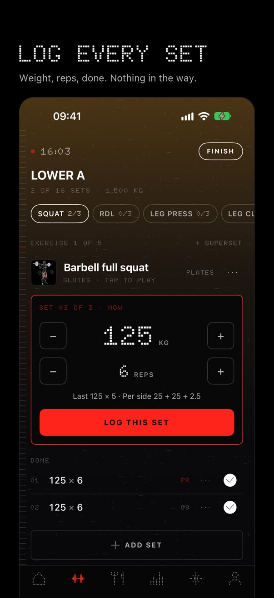
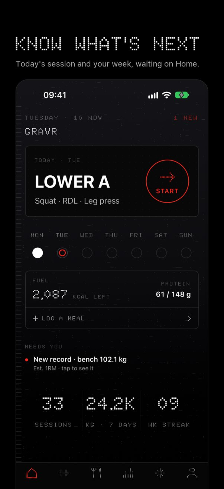
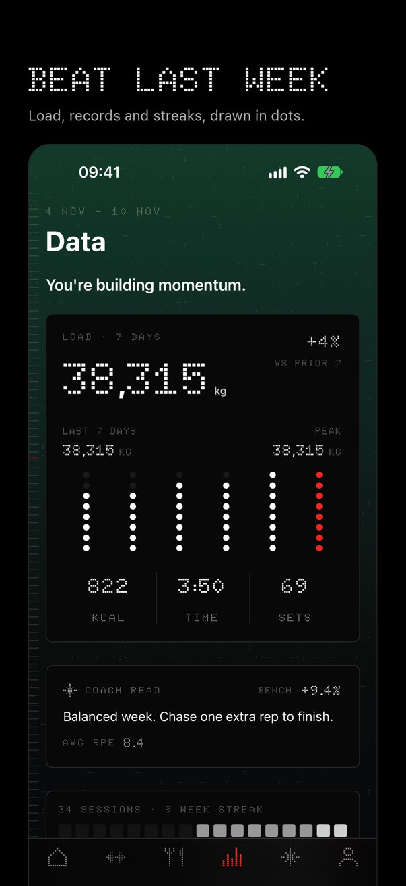
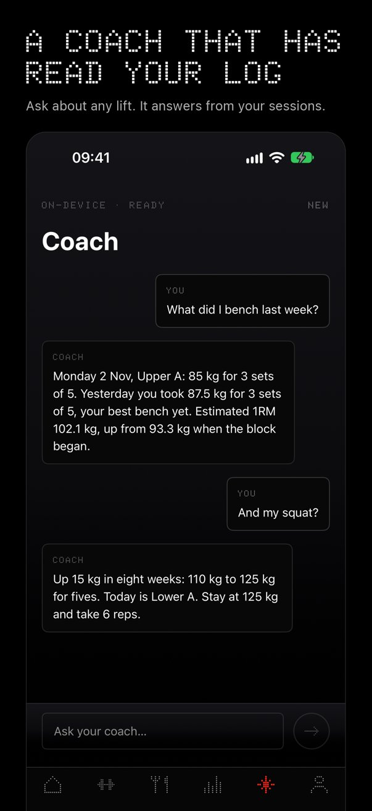

# GRAVR — Dot Matrix Lifting Log

**Log every set. Beat last week.**

GRAVR is a workout and food log for iPhone. Tap to log a set, swap an exercise mid-session, see your week drawn in dots, and ask a coach that has read your log. No account, no ads, no tracking: your log lives on your iPhone and backs up to your own private iCloud.

## Links

- [Website](https://methunrajmani85-del.github.io/gravr-app/)
- [Privacy policy](https://methunrajmani85-del.github.io/gravr-app/privacy/)
- [Support](https://methunrajmani85-del.github.io/gravr-app/support/)

## Help

Questions and problems: [open an issue](https://github.com/methunrajmani85-del/gravr-app/issues). Please do not post personal or health information.

This repository holds GRAVR's public pages. The app's source code is not here.
